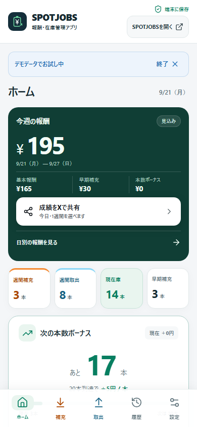
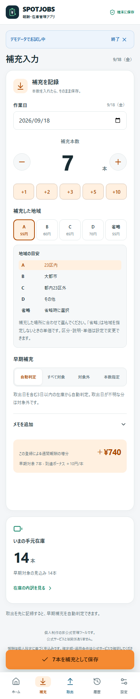
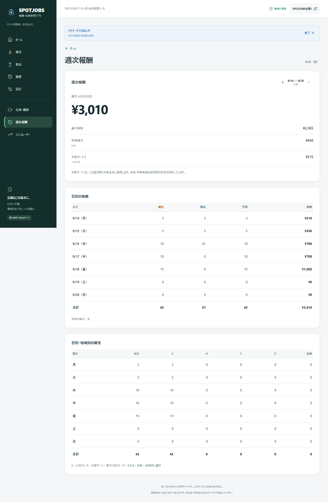
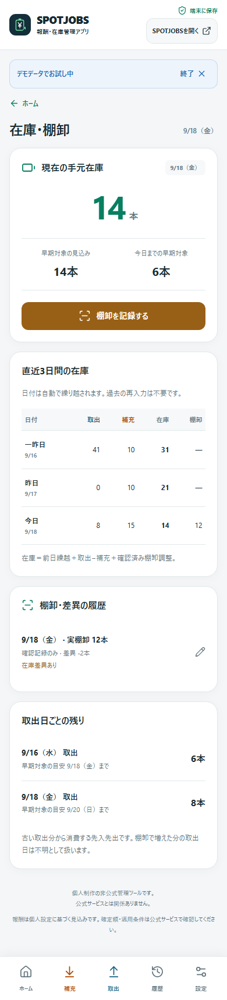
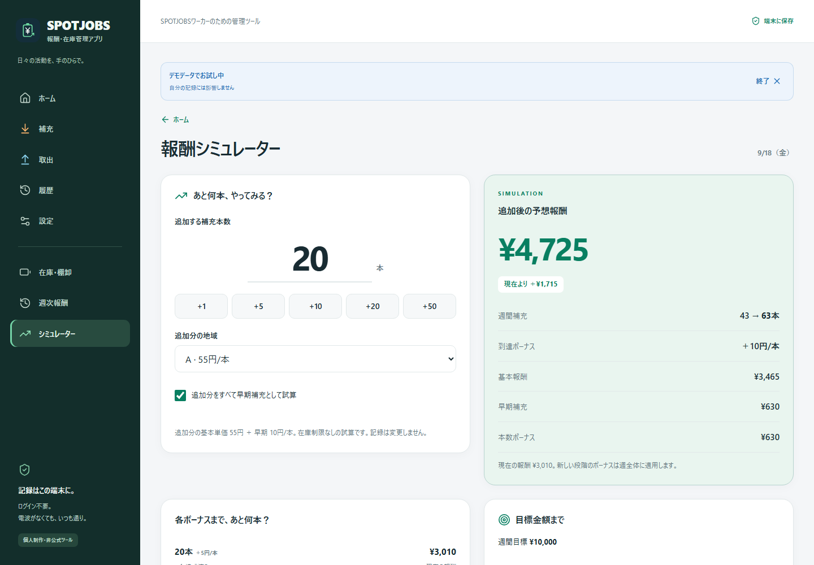

# SPOTJOBS報酬・在庫管理アプリ

補充と取出を手早く記録して、「今週いくら？」「あと何本？」を確認する、SPOTJOBSワーカー向けの個人制作・非公式Webアプリです。

- [公開アプリ](https://spotjobs-reward-inventory-manager.vercel.app)
- [GitHub](https://github.com/shunsoco-stack/spotjobs-reward-inventory-manager)
- [ポートフォリオ・制作背景](docs/portfolio.md)
- [ホームページ掲載用プロンプト・紹介文](docs/publish-copy.md)
- [公開・品質確認レポート](docs/verification.md)

## 概要

スマートフォンでの入力しやすさを中心に、補充・取出・報酬・在庫をひとつの画面構成にまとめました。本数を入力すると、基本報酬、早期補充、週間本数ボーナス、手元の在庫を計算します。

アプリ独自のアカウント登録なしで利用でき、記録と設定は利用中のブラウザへ保存する**ローカルファースト**構成です。個人向けベータの「SPOTJOBS自動取り込み」を任意で有効にすると、ログイン済みEdgeで確認した完了履歴を暗号化して、このアプリへ取り込めます。個人の記録とは別に、デモデータで操作を試せます。

## 作った理由

実際のSPOTJOBSの活動をスプレッドシートで管理する中で、移動中のセル操作や報酬の暗算を減らしたいと考えたことが出発点です。「もう少し続けるか」「あと何本で目標に届くか」を、その場で判断できる道具を目指しました。

参考資料として提供された報酬早見表の考え方も取り入れ、表計算の内容をそのまま並べるのではなく、本数入力、報酬確認、在庫確認という使う場面ごとに整理しています。参考記事の本文や画像をアプリ内へ転載したものではありません。

## 主な機能

| 機能 | できること |
| --- | --- |
| ホーム | 週間報酬の内訳、補充・取出本数、現在庫、目標、次のボーナスを確認 |
| 補充入力 | 大きな数字入力、増減ボタン、+1・+2・+3・+5・+10、地域選択と地域ごとの説明、早期対象、メモ |
| 取出入力 | 日付と本数を記録し、在庫と早期判定に反映 |
| 履歴 | 日付・地域・作業種類で絞り込み、編集・削除、直前の変更を取り消し |
| 週次報酬 | 基本・早期・本数ボーナスの内訳、日別実績、日別・地域別の補充集計 |
| 在庫・棚卸 | 今日・昨日・一昨日の在庫、取出日ごとの残り、棚卸差異を確認。実数へ現在庫をすぐ修正 |
| シミュレーター | 追加本数・地域・早期条件を変更し、報酬と目標までの本数を試算 |
| 設定 | 地域の名称・説明・単価、早期条件、ボーナス段階、週開始曜日、目標、テーマ |
| データ管理 | JSONバックアップ・復元、CSV出力・列割り当て付き取込 |
| スクショ取り込み | ジョブ履歴の画像を端末内で読み取り、日時・種類・本数・店舗名を確認・修正してまとめて登録 |
| 自動取り込み（個人向けベータ） | ログイン済みEdgeでSPOTJOBSの完了履歴を定期確認し、暗号化した補充・取出をWeb／将来のiOS・Android版へ取り込み |
| X共有 | 「今日」または「1週間」を選び、集計内容を確認してからXの投稿画面を開く |
| SPOTJOBSへのアクセス | 各画面の右上から、https://app.spot.jobs/ をワンタップで外部リンクとして開く |
| UI/UX Animation | 画面切替、Sheet、Toast、選択状態、押下、報酬・在庫の数値更新を短いモーションでフィードバック |
| Infographic Animation | 報酬内訳、次Tier、週間目標、月〜日の補充実績を、正確な数値と連動する動くグラフで表示 |
| Kinetic Typography | 画面タイトル、週間報酬、次Tierまでの本数、目標達成率を文字単位の動きで強調 |
| 期間別の報酬 | トップ画面で週間報酬に加えて月次・今年の見込み報酬を表示。前月・次月ボタンで過去月を確認でき、各週の本数ボーナスと保存済み単価を反映 |

ライト、ダーク、端末設定に合わせたテーマを選べます。入力ミスや保存失敗時には内容を確認でき、保存処理が成功するまで入力内容を保持します。モーションは入力を待たせない300〜780msの演出を中心に、画面・カード・Sheet・再計算結果・グラフ・主要な文字を段階的に表示します。文字と数値はDOMへ最初から完成値を保持し、Animation完了を待たず利用できます。端末の「視差効果を減らす／Reduced Motion」設定ではAnimationとTransitionを停止します。

作業の色は**補充＝オレンジ、取出＝水色**です。入力・ナビゲーション・履歴・集計で統一し、色に加えて文字とアイコンでも種類を示しています。

「SPOTJOBSを開く」は別タブで開き、元の入力画面を残します。ホーム画面に追加したPWAでの表示先は端末・ブラウザの動作に従います。公式サービスへのログインや通信は開いた先で行い、記録データをリンクへ付加しません。

### ジョブ履歴のスクリーンショットから登録

1. SPOTJOBSのジョブ履歴で「完了」を開き、完了時間・作業の種類・本数がすべて写るスクリーンショットを保存します。
2. このアプリの補充・取出・履歴、またはホーム下部から「スクショから取り込む」を開きます。
3. JPEG・PNG・WebPを最大5枚選択します。1枚12MB、2,400万画素までです。
4. 読み取り候補の日付・秒までの時刻・補充／取出・本数・店舗名を確認し、誤読を修正します。不要な候補はチェックを外します。
5. 補充の地域・早期対象を確認し、確認欄にチェックしてまとめて保存します。店舗名はメモへ保存され、登録後は通常の履歴から編集・削除できます。

日本語・英語の文字認識はTesseract.jsで**端末内**で行います。画像や認識文字を外部APIへ送信せず、原画像を記録データやバックアップに保存しません。文字認識用プログラムと言語データもアプリと同じ配信元から取得します。初回の読み取りには通信が必要です。一度読み取りを完了し、必要な資産が保存された環境ではオフラインでも再利用できます（Chromiumで確認、保存領域の削除後は再取得が必要）。読み取り中は中止でき、閉じると処理を中止します。

完了日時と種類が一致するスクショ由来の記録は、重複候補として自動で除外します。読み取り結果を修正して保存した場合も、元の読み取り識別子を保持します。通常入力・CSVなどの同日同種の記録は自動で同一作業と断定できないため、重複の可能性を表示します。同じ秒・同じ種類で別ジョブが発生した場合は通常入力から登録してください。

**地域、早期対象、報酬額は画像から推測しません。** 「3日以内で＋10円」などは一般的な案内文として扱います。地域は前回の選択、早期補充は取出記録による自動判定が初期値です。必要に応じて地域・早期対象本数を修正してください。新しい補充記録には現在の地域・早期単価と既存の週条件を保存するため、画像の概算報酬とは異なる場合があります。画像が不鮮明、途中で切れている、画面構成が異なる場合は読み取れないことがあります。候補を確認するまで保存しません。

### SPOTJOBS完了履歴の自動取り込み（個人向けベータ）

PC側のEdge拡張が、ログイン済みの`https://app.spot.jobs/user-job-list`で完了した補充・取出を15／30／60分ごとに確認します。初期値は30分です。PCが起動し、Edgeとログイン済みのジョブ履歴タブが開いている間に取得でき、Edge終了中、PCのスリープ中、ログアウト中は停止します。復帰後の同期で差分を確認します。

1. PCのアプリ設定画面で同期コードを設定します。
2. [Edge拡張](browser-extension/README.md)を展開して読み込み、同じ同期コードを貼り付けます。
3. SPOTJOBSのジョブ履歴をログイン済みで開き、拡張の「今すぐ同期」を実行します。
4. PCの設定にある「スマホ・別端末を接続」を開き、表示されたQRをスマホで読み取ります。
5. スマホで取り込む範囲を確認して接続し、「今すぐ同期」を押すか起動・復帰時の自動確認を待ちます。

同期コードは端末ごとに保存されるため、**同じWebアプリURLを開くだけではスマホへ接続設定が引き継がれません**。Safari／Chrome版とホーム画面版で保存領域が分かれる場合もあるため、普段使う方の画面で接続してください。QRは端末内で生成し、コードをURLのフラグメント（`#`以降）だけに入れます。フラグメントはサーバーへ送らず、受信画面で直ちにURLから削除します。

Edge拡張はSPOTJOBSの**パスワード、Cookie、Local Storage、Session Storage、Authorization Headerを読み取りません**。履歴APIの呼び出しはログイン済みページ内で行い、そのページ自身のセッションだけを利用します。履歴はPC内でAES-256-GCM暗号化してから個人用の同期ブリッジへ送信し、Vercel Private Blobには最新500件までの暗号文と件数・取得日時など最小限のメタデータを、最終更新から最大90日保存します。復号鍵は同期コードから端末内で導出し、サーバーへ送りません。

自動取り込みは**端末間の完全同期やバックアップではありません**。SPOTJOBS側の完了履歴だけを各端末へ追加し、アプリ内で編集した地域・早期対象、棚卸、設定、手入力記録は他端末へ送りません。補充の地域や早期対象を公式履歴から確定できない場合は「要確認」として取り込みます。公式の作業IDと完了日時・種類を使って重複を避け、取り込み後に削除した公式履歴は同じ端末へ再追加しません。

記録が空の新規端末では、同期Inboxに残る最新履歴（最大500件）を取り込みます。既存の手入力・スクリーンショット記録がある端末では、接続時に「過去履歴も取り込む」または「今後の履歴だけ」を選びます。過去取込では一致するスクリーンショット記録を統合しますが、同じ作業を手入力している場合は重複する可能性があります。以前「今後の履歴だけ」で接続した端末も、設定画面から確認後に過去履歴を追加できます。

現在の同期ブリッジは1人での実利用を優先した許可制ベータです。サーバー側に登録した同期チャネルだけ接続でき、同期コードを新しく作っただけでは利用登録は完了しません。同期コードを知る人は暗号文を復号できるため、パスワードと同様に管理してください。QRと接続リンクには同期コードそのものが含まれ、QRスキャナやクリップボードの履歴に残る場合があります。自分の端末だけで利用し、共有しないでください。

### 今日・1週間の成績をXへ共有

ホームの「成績をXで共有」から**今日**または**1週間**を選び、補充・取出・早期補充・見込み報酬を投稿前に確認できます。1週間はホームで表示中の週が対象なので、過去週へ移動してその週の成績も共有できます。次の週間本数ボーナスまでの残り本数も表示します。デモモードの集計には「デモ」と明記し、個人の実績と取り違えないようにしています。

「Xで共有画面を開く」を押すと、`#SPOTJOBS記録 #SPOTJOBS`を含む集計文を入れた`x.com`の投稿画面を別タブで開きます。**投稿は自動で確定せず**、X側で内容を確認して投稿します。店舗名、メモ、個別の履歴、現在庫は共有文へ含めません。プレビューの表示までは端末内で完結し、Xの投稿画面を開く操作にはネットワーク接続が必要です。

## 報酬計算

```text
週間報酬 ＝ 基本報酬 ＋ 早期補充ボーナス ＋ 週間本数ボーナス
基本報酬 ＝ 各補充記録の本数 × その記録の地域単価 の合計
早期補充ボーナス ＝ 各記録の対象本数 × その記録の早期単価 の合計
週間本数ボーナス ＝ 週間補充総数 × 到達段階の追加単価
```

作業日は日本時間で扱います。週は初期設定で月曜〜日曜ですが、開始曜日を変更できます。

補充記録には、地域単価、早期単価、早期対象日数、週開始日、本数ボーナス表を保存します。設定変更によって過去の記録を現在の単価で再計算しません。すでに記録がある週では、その週の区切りとボーナス表を維持し、新しい週から変更した条件を使います。

## 地域別単価

以下は**個人管理用の変更可能な初期値**です。公式料金表の提供や報酬額の保証ではありません。

| 地域名 | 初期説明 | 初期単価 |
| --- | --- | ---: |
| A | 23区内 | 55円／本 |
| B | 大都市 | 60円／本 |
| C | 都内23区外 | 65円／本 |
| D | その他 | 70円／本 |
| 省略 | 省略時に選択 | 55円／本 |

地域省略はAとは別の設定です。初期の入力地域は省略に設定してあり、地域名、説明、単価、入力時の初期地域を変更できます。

旧版のデータを読み込んだ場合は、旧版で使用していたB＝65円・C＝60円を含む設定を維持します。初期値への置き換えや過去の単価の入れ替えは行いません。

## 早期補充

初期設定は、**取出日を含む3日以内・対象1本につき10円**です。取出記録がある在庫を古い順に消費したと仮定し、早期対象の本数を推定します。

補充入力では「自動判定」「すべて対象」「対象外」「本数指定」を選べます。実際の条件と推定が異なる場合は手動で指定してください。取出日が不明な在庫や、取出未記録の本数には早期ボーナスを自動加算しません。

## 週間本数ボーナス

| 週間補充本数 | 初期追加単価 |
| --- | ---: |
| 0〜19本 | 0円／本 |
| 20〜49本 | 5円／本 |
| 50〜99本 | 10円／本 |
| 100〜149本 | 15円／本 |
| 150本以上 | 20円／本 |

到達した段階の単価を、その週の**全補充本数**に適用します。例えば49本から50本へ増えると、追加した1本分だけでなく、週間本数ボーナス全体も変わります。

設定は1〜10段階。最初の段階は0本、開始本数は重複しない昇順、追加単価は前段階以上とします。画面入力とデータ取込の両方で検証します。

## 「あと何本？」機能

次のボーナス段階までの残り本数と、その段階へ届いた場合の予想報酬を表示します。週間目標についても、選んだ地域と早期条件の下で、目標へ最初に届く追加本数を計算します。

基本単価だけで割り算せず、途中で本数ボーナスの段階が変わる場合も反映します。画面に試算条件を表示し、シミュレーターから変更できます。

## 在庫管理

```text
現在庫 ＝ 前日繰越 ＋ 取出 − 補充 ＋ 反映済みの棚卸調整
```

今日・昨日・一昨日の表示は、日付が変わると繰り越します。取出日ごとの残りと、今日までの早期対象も確認できます。

取出の記録が足りない場合は、理論在庫をマイナスのまま表示し、記録漏れを知らせます。不足分を自動的に0へ丸めたり、存在しない取出記録を作ったりしません。

公式側の作業エラーなどで記録上の在庫だけが実物とずれた場合は、ホームまたは在庫画面の「現在庫を編集」から実際の保有数へ修正できます。変更前後と差分を確認してから反映し、補充・取出本数や報酬は変更しません。修正は棚卸・差異の履歴に残り、保存直後は取り消せます。

## 棚卸

実際に数えた本数を記録し、記録上の在庫との差分を確認できます。初期状態は**確認記録のみ**で、棚卸しただけでは在庫を変更しません。

「棚卸数を在庫に反映する」を選ぶと、変更前後の本数と差異を確認してから反映します。確認のみ・反映済みの状態は履歴に残ります。「現在庫を編集」は、この反映操作を日常の修正向けに短くした導線です。棚卸または現在庫修正で増えた在庫の取出日は不明として扱い、自動の早期対象から外します。

## 報酬シミュレーター

追加する補充本数、地域、追加分をすべて早期対象とするかを選び、次の内容を比較できます。

- 追加後の予想報酬と現在との差額
- 基本・早期・週間本数ボーナスの内訳
- 各ボーナス段階までの残り本数と到達時の報酬
- 週間目標へ届く追加本数

試算によって活動記録や在庫は変わりません。追加本数は在庫制限なしの仮定で計算します。

## PWA / Offline

本番ビルドはWeb App ManifestとService Workerを含みます。**初回はオンラインで開き、画面と必要なファイルの保存が完了してから**オフラインで入力・履歴・計算を利用できます。

- iPhone：Safariの共有メニューから「ホーム画面に追加」
- Android：ブラウザの「アプリをインストール」または「ホーム画面に追加」。対応環境では設定画面にもインストールボタンを表示

HTTPSまたはlocalhostで利用します。開発モードではService Workerを登録しません。初回アクセス前、キャッシュ削除後、ブラウザが保存領域を削除した後は、オンラインでの再読み込みが必要です。

## データ保存方式

記録と設定は、利用中のブラウザの**IndexedDB**へ保存します。自動取り込みを使わない場合、作業記録を開発者の同期サーバーへ送りません。ブラウザ・端末・URLが異なれば保存領域も別です。

自動取り込みを有効にした場合も、取り込んだ記録と設定の正本は各端末のIndexedDBです。Edge拡張は公式側の完了履歴を暗号化し、同期ブリッジは暗号化Envelope（暗号文、IV、件数、取得日時、送信元識別）だけをPrivate Blobへ保存します。同期コードと復号鍵、SPOTJOBSのパスワード・Cookie・認証Tokenはサーバーへ送りません。暗号化Envelopeは最終保存から最大90日で期限切れになり、設定画面から削除できます。

同期コードは作業データやJSONバックアップへ含めず、Web／PWAではそのブラウザのlocalStorage、Edge拡張では拡張機能のローカル保存領域へ保存します。現在準備中のnative版ではWebView内のローカル保存を使用するため、正式なiOS／Android公開に向けてKeychain／Keystoreへ移すことを追加の堅牢化項目としています。

保存はトランザクションの完了まで確認し、別タブで先に変更された場合は古い内容で上書きせず通知します。デモは個人データと分離しています。

旧localStorage版は、読み込み時に記録時の報酬条件を付けて移行します。旧棚卸は当時の動作に合わせて反映済みとして移行し、元のlocalStorageは移行元の控えとして保持します。

ブラウザデータの削除、端末故障、プライベートブラウズの終了などで記録が失われる場合があります。端末やURLを変える前に、JSONバックアップを保存してください。

## Backup / Restore

**JSON**は設定と全記録をまとめて保存する形式です。バックアップ作成日時、件数、記録期間を復元前に確認し、内容を確認してから現在のデータを置き換えます。復元前に現在のバックアップを保存できます。

**CSV**は表計算との受け渡しに使います。UTF-8、見出し行、引用符付きのカンマ・改行に対応し、日付・本数・作業種類・地域・早期対象・メモの列を割り当てて取り込みます。行ごとのエラーと内容を確認してから、既存記録へ追加します。日付には年が必要です。通常CSVの地域空欄は設定の初期地域を使い、新しい記録の条件として保存します。

このアプリから出力したCSVには、報酬条件・棚卸状態・ID・メモをそのまま復元するための**「記録データ（JSON）」列**が含まれます。この列があれば、その内容を優先します。表計算で通常列を編集し、その編集結果を読み込みたい場合は、この列を削除してから列割り当てで取り込んでください。CSVは設定全体のバックアップにはならないため、端末移行にはJSONを推奨します。

不正な形式、存在しない日付、不正な数値、重複ID、上限超過を検証します。取込エラーで既存データを消すことはありません。CSVの数式として扱われ得る文字列は、出力時に無効化します。

## Screenshots

2026年9月21日にVercel本番環境で撮影した実際の画面です。ホーム・補充入力・在庫の3枚はスマートフォン幅、週次報酬・シミュレーターの2枚はデスクトップ幅です。個人の作業履歴は使わず、アプリのデモモードで撮影しています。[撮影条件と画像の記録](docs/screenshots/capture.json)も保存しています。

### ホーム



### 補充入力



### 週次報酬



### 在庫・棚卸



### 報酬シミュレーター



## 使用技術

| 領域 | 技術 |
| --- | --- |
| UI | Next.js 16、React 19、TypeScript、CSS、Lucide、端末内QR生成（qrcode） |
| 保存 | IndexedDB、旧localStorageデータの移行、同期設定用localStorage |
| 自動取り込み | Edge Manifest V3拡張、Web Crypto API（HKDF-SHA-256、AES-256-GCM） |
| 暗号化同期ブリッジ | Vercel Functions、Private Vercel Blob、許可チャネル制御、90日保持 |
| スクリーンショット読取 | Tesseract.js 7、日本語・英語モデル、Web Worker / WebAssemblyによる端末内OCR |
| ファイル | JSONバックアップ、CSV解析・出力 |
| オフライン | Web App Manifest、Service Worker、静的エクスポート |
| iOS準備 | Capacitor 8、Share、Filesystem、外部ブラウザ連携 |
| 品質確認 | Vitest、fake-indexeddb、Playwright、TypeScript、ESLint、GitHub Actions |
| 配信構成 | Vercel対応の静的ホスティング設定 |

## Testing

Node.js 22以上を使用します。このディレクトリで実行してください。

```sh
npm ci
npm test
npm run typecheck
npm run lint
npm run build
npm run test:e2e
npm run verify:ios
```

主なテスト対象は、報酬の段階境界、週の区切り、単価保存、先入先出、負在庫、棚卸、現在庫の直接修正と取消、シミュレーション、JSON移行・復元、IndexedDBの保存完了・競合、CSVの引用符・列対応・不正行です。スクショ取り込みでは日時・本数の解析、重複除外、補正後の重複、単価保存、OCRの中止・タイムアウト・資源解放も検証します。自動取り込みでは暗号化Protocol、認証用Tokenと暗号鍵の分離、公式ID／スクショ記録との重複回避、要確認、削除後の再取込防止、Bridgeの認証・入力検証・保持期限に加え、QR接続コードのURLからの即時除去、既存データ端末の取込範囲選択、今後のみ同期からの確認付き過去取込、QRキャンバスの端末内生成を検証します。X共有では今日・1週間の集計文、デモ表記、共有対象外の情報、`x.com`投稿URLを検証します。UI/UX Animationでは通常時の画面・Sheet・Toastの動き、Reduced Motion時の停止、操作継続、Sheetのスクロールロック解除、横スクロールとConsole Errorの有無を検証します。公開テストは合成データを使い、IndexedDBの単体テストはfake-indexeddb上で行います。

テストファイルは `src/lib/core.test.ts`、`src/lib/storage.test.ts`、`src/lib/csv.test.ts`、`src/lib/job-screenshot.test.ts`、`src/lib/screenshot-ocr.test.ts`、`src/lib/native-runtime.test.ts`、`src/lib/share.test.ts`、`src/lib/sync/*.test.ts`。Edge拡張と同期ブリッジは、それぞれのディレクトリで独立した単体テストを実行できます。GitHub Actionsではlint、型検査、テスト、ビルド、静的ファイルとOCR資産に加え、`macos-26`上で毎回Capacitor projectを生成し、署名なしのiOS Simulator buildまで確認します。

2026年11月15日の結果：lint・型検査・ビルド成功、本体の単体テスト212件、Edge拡張13件、同期ブリッジ21件が成功。Production依存関係のnpm auditは既知脆弱性0件です。54本すべて早期補充の4,050円、および19/20/49/50/99/100/149/150本の境界を含みます。ローカルのブラウザテストは50件成功・1件スキップで、現在庫の修正・差分履歴・報酬維持・取消、Xの投稿URL、今日／1週間、過去週、QRによる端末接続、自動取り込み、確認付き過去取込、削除後の再取込防止、オフライン表示、UI/UX Animation、Reduced MotionをDesktop Chromium、Pixel 7相当、iPhone 13 WebKit相当の3構成で確認しました。スキップは既知のWebKitオフライン再起動テストです。成功したテストのコンソールエラーは0件でした。スクショ取り込みは実画像でも読み取り・訂正・保存・取消・重複除外を別途確認しています。検証に使った個人画像・認識文字は公開リポジトリへ含めていません。

Desktop Chromium、Pixel 7相当、iPhone 13相当で入力・報酬・棚卸・履歴・JSON/CSV・テーマを検証しています。Chromiumでは完全オフラインで再起動・保存・再読込も成功しました。WebKitではオフライン入力・保存を確認しましたが、オフライン再起動は検証環境の制約でスキップしています。**iPhone Safari実機でのオフライン再起動は未検証**です。実行方法と構成別の結果は[ブラウザ検証](e2e/README.md)を参照してください。

## Deployment

Vercel Production：[SPOTJOBS報酬・在庫管理アプリ](https://spotjobs-reward-inventory-manager.vercel.app)。未ログインのブラウザからアクセスできることを確認しています。

App Store提出と利用者サポートに使う公開ページ：

- [プライバシーポリシー](https://spotjobs-reward-inventory-manager.vercel.app/privacy)
- [サポート](https://spotjobs-reward-inventory-manager.vercel.app/support)

現在のバージョンでは、作業記録と設定を端末内のIndexedDBに保存し、スクリーンショットのOCRも端末内で実行します。アプリ独自の利用者アカウント、アクセス解析SDK、広告SDKはありません。任意の自動取り込みでは、Edge拡張で暗号化した公式完了履歴だけを別Vercelプロジェクトの同期ブリッジへ送り、Private Blobへ最大90日保存します。ブリッジは`sync-bridge/`、拡張は`browser-extension/`として本体と分離しています。データの削除・保存期間、バックアップ、外部リンク利用時の扱いはプライバシーポリシーに明記しています。不具合・要望は公開GitHub Issuesで受け付けるため、実際の作業記録や個人情報を投稿しないようサポートページで案内しています。Web・iOS・Androidへの広告掲載は将来計画で、事業者、広告ID、同意設計が確定してから各版へ追加します。

iOS共通層にはCapacitor 8を導入済みです。nativeではService Workerを使わず同梱資産で動作し、公式サイトとXを外部ブラウザで開き、JSON／CSVをiOS共有シートから保存します。Web版とiOS版の保存領域は別です。自動取り込みは公式完了履歴だけを各端末へ追加するため、設定・棚卸・手入力記録を含む完全な移行にはJSONバックアップを使います。

Macでの生成・同期手順は[iOS build handoff](docs/IOS_BUILD.md)、TestFlightからApp Store公開までMac版Codexへ引き継ぐ場合は[Mac版Codex向け iOSリリース引き継ぎプロンプト](docs/MAC_IOS_RELEASE_PROMPT.md)を使用してください。申請前の証跡は[App Store release readiness checklist](docs/APP_STORE_RELEASE_CHECKLIST.md)、native画像の撮影条件は[App Store screenshot plan](docs/app-store/screenshots/README.md)にまとめています。`npm run ios:preflight`でWeb品質とiOS入力資産を一括確認でき、生成後は`npm run ios:verify-native`でXcode project、Bundle ID、deployment target、plugin、AppIcon、Privacy Manifest、同梱OCRの同期を確認できます。

Macで最終App Store名とBundle IDを確定した後、`ios/`がない初回は`npm run ios:release-preflight -- --identity-confirmed`、既存`ios/`の再検証は`npm run ios:release-preflight`を使うと、local E2Eから署名なしSimulator buildとApp.app内Privacy Manifest確認までを一括実行し、`.artifacts/ios-release-preflight.md`へ証跡を残せます。

開発サーバー：

```sh
npm ci
npm run dev
```

[http://localhost:3058](http://localhost:3058) で開きます。本番ビルドとプレビュー：

```sh
npm run build
npm run preview
```

プレビューは [http://localhost:3059](http://localhost:3059)。`scripts/prepare-ocr.mjs`、`next build`、`scripts/build-offline.mjs` により `out/` へ静的ファイル、OCR資産、Service Workerを生成します。OCR資産は固定バージョンのnpmパッケージから準備し、生成物はGitへ含めません。日本語モデルの旧エンジン設定だけを互換化し、元のチェックサムと学習データの不変性をビルド時に検証します。ライセンスと変更内容は `/ocr/licenses/` に同梱します。Vercelでは同梱の `vercel.json` を使い、`out/` 全体を配信します。ほかの静的ホスティングではHTTPSとルート配信を用意してください。

開発・プレビュー・公開URLの保存領域は別々です。公開先を変える際はJSONで移行してください。

## 注意事項

- 個人制作の非公式アプリです。SPOTJOBS、ChargeSPOT、株式会社INFORICHとの提携・関係はありません。
- 報酬は入力内容と個人設定に基づく目安です。最新条件、対象エリア、早期対象、確定額は公式アプリで確認してください。
- 単価の自動取得、決済、給与の支払いは行いません。自動取り込みは利用者がログイン済みのEdgeタブで完了履歴を確認する機能で、ログイン情報を同期ブリッジへ送りません。
- 在庫と早期対象は記録に基づく計算です。実物と異なる場合は履歴を確認し、必要に応じて棚卸または「現在庫を編集」で実数へ合わせてください。
- データの正本はブラウザ内に保存されます。自動取り込みはバックアップや完全な端末間同期ではないため、継続して利用する場合は定期的にJSONバックアップを保存してください。

